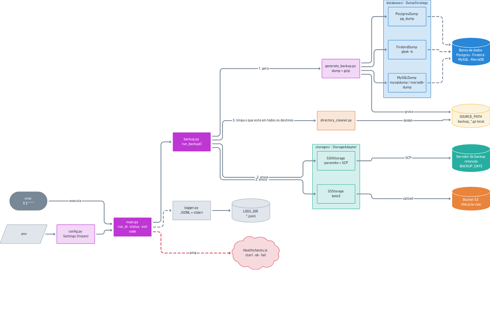

# Python Backup Script

Gera periodicamente o backup de um banco de dados no servidor de produção e envia o arquivo
para um servidor de backup via SSH/SCP e/ou para um bucket AWS S3 (variável `BACKUP_TARGETS=ssh|s3|ssh,s3`).

O arquivo local só é apagado depois de estar em **todos** os destinos configurados; se algum
destino falhar, ele fica em `SOURCE_PATH` e é reenviado na próxima execução.

Engines suportados (variável `DB_ENGINE`):

| Engine     | Ferramenta | Arquivo gerado                         |
|------------|------------|----------------------------------------|
| `postgres` | `pg_dump`  | `backup_YYYYmmdd_HHMMSS.sql[.gz]`      |
| `firebird` | `gbak -b`  | `backup_YYYYmmdd_HHMMSS.fbk[.gz]`      |
| `mysql`    | `mysqldump`    | `backup_YYYYmmdd_HHMMSS.sql[.gz]`  |
| `mariadb`  | `mariadb-dump` | `backup_YYYYmmdd_HHMMSS.sql[.gz]`  |

Com `COMPRESS_BACKUP=true` (padrão), o arquivo é comprimido com gzip antes do envio.

## Arquitetura

O script roda no servidor do banco, disparado pelo cron, e cada execução é independente: gera o dump,
envia para os destinos e termina. Não há serviço rodando em segundo plano nem estado guardado entre
execuções além dos arquivos em `SOURCE_PATH` (o que não foi enviado a todos os destinos fica lá e é
reenviado na próxima execução).



Fonte editável no Whimsical: [Arquitetura do Backup Script](https://whimsical.com/Su7Aqx5jonLTd2jTQXHtSm).
Ao alterar o board, exporte a imagem de novo para `docs/arquitetura.png`.

### Fluxo de uma execução

1. `main.py` gera o `run_id`, configura o log, registra `run.started` e envia `start` ao Healthchecks.
2. `build_dump_strategy` e `build_storages` montam a estratégia de dump do `DB_ENGINE` e um adapter por
   destino de `BACKUP_TARGETS`. Erro de configuração aqui interrompe a execução antes do dump.
3. `run_backup` (`backup.py`) chama `generate_backup`, que roda a ferramenta de dump e comprime o arquivo.
   Se falhar, o arquivo parcial é removido.
4. Para cada destino: `connect()` → `upload()` → `apply_retention()`. Arquivos que já estão no destino são
   pulados. A falha de um destino não impede os outros.
5. Só os arquivos confirmados em **todos** os destinos são apagados de `SOURCE_PATH`.
6. As conexões são fechadas, `run.finished` registra o resumo e o Healthchecks recebe `ok` ou `fail`.
   O status é `success`, `partial` ou `failed` (ver [Logs e auditoria](#logs-e-auditoria)).

### Onde fica cada coisa

| Módulo                     | Responsabilidade |
|----------------------------|------------------|
| `app/main.py`              | Ponto de entrada: monta as peças, trata erros, define status e exit code. |
| `app/config.py`            | Lê o `.env` e expõe `settings` (dataclass congelada, com um bloco por banco/destino). |
| `app/backup.py`            | Orquestra gerar → enviar → limpar. |
| `app/generate_backup.py`   | Roda a ferramenta de dump (`run_dump_command`) e comprime com gzip. |
| `app/databases/`           | Uma `DumpStrategy` por engine e a fábrica `build_dump_strategy`. |
| `app/storages/`            | Um `StorageAdapter` por destino e a fábrica `build_storages`. |
| `app/ssh_client.py`, `app/s3_client.py` | Criação dos clientes e operações de baixo nível (paramiko, boto3). |
| `app/directory_cleaner.py` | Limpeza local (`SOURCE_PATH`) e retenção remota no servidor SSH. |
| `app/logger.py`            | Log estruturado em JSONL + saída legível no `stderr`. |
| `app/healthcheck.py`       | Ping ao Healthchecks.io. Nunca lança exceção. |
| `app/utils.py`             | Datas a partir do nome do arquivo, tamanhos, buscas no servidor remoto. |
| `tests/`                   | Testes por módulo, no padrão `test_<módulo>.py` (`uv run task test`). |

Para incluir um banco ou um destino novo, veja [Adicionando um banco ou um storage](#adicionando-um-banco-ou-um-storage).

## Configuração

Copie `.env.example` para `.env` e preencha as variáveis. Quais blocos você precisa preencher
depende de duas escolhas:

- `DB_ENGINE` define **qual banco** é copiado: preencha só o bloco `PG_*`, o `FB_*` ou o `MYSQL_*`
  (usado tanto por `mysql` quanto por `mariadb`).
- `BACKUP_TARGETS` define **para onde** o backup vai: preencha o bloco `SSH_*` + `DEST_PATH` (ssh),
  o bloco `S3_*` / `AWS_*` (s3), ou os dois (`ssh,s3`).

### Variáveis

**Gerais** (sempre necessárias)

| Variável          | Obrigatória | Padrão          | Descrição |
|-------------------|-------------|-----------------|-----------|
| `ENVIRONMENT`     | sim         | —               | Use `prod` no servidor. Com `dev`, `SOURCE_PATH` e `LOGS_DIR` são ignorados (usa `/srv/test_app/backup` e `./logs`). |
| `SOURCE_PATH`     | sim         | —               | Diretório **local** onde o dump é gerado antes do envio. Precisa existir e ter permissão de escrita. Os arquivos são apagados daqui depois de enviados a todos os destinos. |
| `LOGS_DIR`        | recomendada | `<projeto>/logs`| Diretório dos logs (`backup_script_YYYY-MM-DD.jsonl`, ver [Logs e auditoria](#logs-e-auditoria)). Defina sempre ao usar o binário. |
| `DB_ENGINE`       | não         | `postgres`      | `postgres`, `firebird`, `mysql` ou `mariadb`. |
| `COMPRESS_BACKUP` | não         | `true`          | Comprime o dump com gzip (`.gz`). |
| `BACKUP_TARGETS`  | não         | `ssh`           | `ssh`, `s3` ou `ssh,s3`. |
| `HEALTHCHECK_URL` | não         | —               | URL de ping do [Healthchecks.io](https://healthchecks.io) (`https://hc-ping.com/<uuid>`). Vazio = desligado. Ver [Monitoramento](#monitoramento-healthchecksio). |

**PostgreSQL** (`DB_ENGINE=postgres`)

| Variável      | Obrigatória | Padrão      | Descrição |
|---------------|-------------|-------------|-----------|
| `PG_HOST`     | não         | `localhost` | Host do banco. |
| `PG_PORT`     | não         | `5432`      | Porta do banco. |
| `PG_DB_NAME`  | sim         | —           | Nome do banco. |
| `PG_USER`     | sim         | —           | Usuário com permissão de leitura em todo o banco. |
| `PG_PASSWORD` | sim         | —           | Senha (passada ao `pg_dump` via `PGPASSWORD`). |

**Firebird** (`DB_ENGINE=firebird`)

| Variável       | Obrigatória | Padrão      | Descrição |
|----------------|-------------|-------------|-----------|
| `FB_HOST`      | não         | `localhost` | Host do banco. |
| `FB_PORT`      | não         | `3050`      | Porta do banco. |
| `FB_DATABASE`  | sim         | —           | Caminho completo do `.fdb` no servidor ou alias do `databases.conf`. |
| `FB_USER`      | não         | `SYSDBA`    | Usuário. |
| `FB_PASSWORD`  | sim         | —           | Senha. |
| `FB_GBAK_PATH` | não         | `gbak`      | Caminho do `gbak` (veja [Firebird: `gbak`](#firebird-gbak)). |

**MySQL / MariaDB** (`DB_ENGINE=mysql` ou `DB_ENGINE=mariadb`)

| Variável          | Obrigatória | Padrão      | Descrição |
|-------------------|-------------|-------------|-----------|
| `MYSQL_HOST`      | não         | `localhost` | Host do banco. Com `localhost` o cliente usa o socket Unix; use `127.0.0.1` para forçar TCP. |
| `MYSQL_PORT`      | não         | `3306`      | Porta do banco. |
| `MYSQL_DATABASE`  | sim         | —           | Nome do banco. |
| `MYSQL_USER`      | sim         | —           | Usuário (veja os privilégios em [MySQL / MariaDB](#mysql--mariadb)). |
| `MYSQL_PASSWORD`  | sim         | —           | Senha (passada via arquivo de opções temporário, nunca na linha de comando). |
| `MYSQL_DUMP_PATH` | não         | vazio       | Caminho do binário de dump. Vazio = `mysqldump` (`mysql`) ou `mariadb-dump` (`mariadb`) do `PATH`. |

**SSH** (`BACKUP_TARGETS` contém `ssh`)

| Variável       | Obrigatória | Padrão | Descrição |
|----------------|-------------|--------|-----------|
| `SSH_SERVER`   | sim         | —      | Host do servidor de backup. |
| `SSH_PORT`     | não         | `22`   | Porta SSH. |
| `SSH_USER`     | sim         | —      | Usuário SSH. |
| `PUB_KEY_PATH` | sim         | —      | Caminho da chave **privada** SSH (ex.: `/home/backup/.ssh/id_ed25519`). A chave pública correspondente deve estar no `authorized_keys` do servidor de backup. |
| `DEST_PATH`    | sim         | —      | Diretório no servidor de backup. É criado se não existir. |
| `BACKUP_DAYS`  | não         | `7`    | Retenção no servidor de backup: arquivos mais antigos que N dias são apagados lá. |

> `SSH_PASSWORD` existe no `.env.example`, mas hoje a autenticação é feita só por chave.

**AWS S3** (`BACKUP_TARGETS` contém `s3`)

| Variável                | Obrigatória | Padrão      | Descrição |
|-------------------------|-------------|-------------|-----------|
| `S3_BUCKET`             | sim         | —           | Nome do bucket (sem `s3://`). |
| `S3_PREFIX`             | não         | vazio       | "Pasta" dentro do bucket (ex.: `backups/postgres`). |
| `AWS_REGION`            | não         | `us-east-1` | Região do bucket (ex.: `sa-east-1`). |
| `AWS_ACCESS_KEY_ID`     | sim         | —           | Access key do usuário IAM do script. |
| `AWS_SECRET_ACCESS_KEY` | sim         | —           | Secret key do usuário IAM do script. |
| `S3_STORAGE_CLASS`      | não         | `STANDARD`  | Classe de armazenamento (veja a nota em [AWS S3](#aws-s3)). |

No S3, `DEST_PATH`, `BACKUP_DAYS` e as variáveis `SSH_*` não são usadas e podem ficar vazias.
A retenção é feita pela lifecycle rule do bucket.

### Exemplo: PostgreSQL → S3

```bash
ENVIRONMENT="prod"
SOURCE_PATH="/var/backups/db"
LOGS_DIR="/var/log/backup_script"

DB_ENGINE="postgres"
COMPRESS_BACKUP="true"
BACKUP_TARGETS="s3"

PG_HOST="localhost"
PG_PORT="5432"
PG_DB_NAME="meu_banco"
PG_USER="backup_user"
PG_PASSWORD="********"

S3_BUCKET="minha-empresa-backups"
S3_PREFIX="backups/postgres"
S3_STORAGE_CLASS="STANDARD"
AWS_REGION="sa-east-1"
AWS_ACCESS_KEY_ID="AKIA..."
AWS_SECRET_ACCESS_KEY="********"
```

### Exemplo: Firebird → SSH + S3

```bash
ENVIRONMENT="prod"
SOURCE_PATH="/var/backups/db"
LOGS_DIR="/var/log/backup_script"

DB_ENGINE="firebird"
BACKUP_TARGETS="ssh,s3"

FB_DATABASE="/var/lib/firebird/data/database.fdb"
FB_USER="SYSDBA"
FB_PASSWORD="********"
FB_GBAK_PATH="gbak"

SSH_SERVER="backup.minhaempresa.com.br"
SSH_PORT="22"
SSH_USER="backup"
PUB_KEY_PATH="/home/backup/.ssh/id_ed25519"
DEST_PATH="/srv/backups/firebird"
BACKUP_DAYS="7"

S3_BUCKET="minha-empresa-backups"
S3_PREFIX="backups/firebird"
AWS_REGION="sa-east-1"
AWS_ACCESS_KEY_ID="AKIA..."
AWS_SECRET_ACCESS_KEY="********"
```

### Firebird: `gbak`

`FB_GBAK_PATH` aceita o caminho completo (`/opt/firebird/bin/gbak`) ou só `gbak`, se ele estiver no `PATH`.
Como a instalação oficial do Firebird coloca o binário em `/opt/firebird/bin`, fora do `PATH`, dá para
criar um symlink e manter o padrão `FB_GBAK_PATH="gbak"`:

```bash
sudo ln -s /opt/firebird/bin/gbak /usr/bin/gbak
```

O script roda `gbak -b -v -g <host>/<porta>:<banco> <arquivo.fbk>` (`-g` desativa o garbage collection durante
o backup, o que deixa o processo mais rápido). As credenciais vão pelas variáveis de ambiente `ISC_USER` e
`ISC_PASSWORD`, que o gbak lê sozinho, e não por argumentos, para a senha não aparecer no `ps`. Para testar
o mesmo comando à mão:

```bash
ISC_USER=SYSDBA ISC_PASSWORD=<senha> gbak -b -v -g localhost/3050:/caminho/banco.fdb teste.fbk
# ou, com as credenciais como switches:
gbak -b -v -g -user SYSDBA -password <senha> localhost/3050:/caminho/banco.fdb teste.fbk
```

`FB_DATABASE` deve ser o caminho completo do `.fdb` no servidor, ou um alias definido em `databases.conf`.

## MySQL / MariaDB

O script roda:

```bash
mysqldump --defaults-extra-file=<tmp> --host=<host> --port=<porta> --user=<usuario> \
  --single-transaction --quick --routines --triggers --events --no-tablespaces --verbose \
  --set-gtid-purged=OFF --result-file=<arquivo.sql> <banco>
```

Com `DB_ENGINE=mariadb` o binário é `mariadb-dump` e não há `--set-gtid-purged` (opção só do MySQL).

- A senha vai num arquivo de opções temporário (`[client] password=...`, permissão `0600`) apagado logo
  depois do dump, para não aparecer no `ps` nem depender do `MYSQL_PWD` (descontinuado no MySQL 8).
- `--single-transaction` gera um dump consistente de tabelas InnoDB sem travar o banco.
- `--no-tablespaces` evita exigir o privilégio `PROCESS` (MySQL 8.0.21+).
- Use o binário da mesma família e versão igual ou maior que a do servidor (`mysqldump` para MySQL,
  `mariadb-dump` para MariaDB).

Usuário mínimo para o backup:

```sql
CREATE USER 'backup'@'localhost' IDENTIFIED BY '<senha>';
GRANT SELECT, SHOW VIEW, TRIGGER, LOCK TABLES, EVENT ON <banco>.* TO 'backup'@'localhost';
```

Se o dump falhar em `--routines` (ou as rotinas saírem sem corpo), conceda também `SHOW_ROUTINE`
(MySQL 8.0.20+: `GRANT SHOW_ROUTINE ON *.* TO ...`) ou `SELECT` global. Teste o comando acima à mão com o
usuário do backup antes de agendar.

## AWS S3

O envio usa `boto3` (não precisa do AWS CLI instalado). Preencha o bloco `S3_*` / `AWS_*` do `.env`
e proteja o arquivo: `chmod 600 .env`.

Policy IAM mínima para o usuário do script (sem permissão de delete, o que protege os backups se a chave vazar):

```json
{
  "Version": "2012-10-17",
  "Statement": [
    {
      "Effect": "Allow",
      "Action": ["s3:PutObject", "s3:GetObject"],
      "Resource": "arn:aws:s3:::<bucket>/<prefix>/*"
    }
  ]
}
```

A retenção no S3 é feita pela lifecycle rule do bucket (o script não apaga nada no S3).
Exemplo com expiração em 7 dias (configure uma vez, com uma conta que tenha permissão no bucket):

```bash
aws s3api put-bucket-lifecycle-configuration --bucket <bucket> --lifecycle-configuration '{
  "Rules": [{
    "ID": "expire-backups",
    "Status": "Enabled",
    "Filter": {"Prefix": "<prefix>/"},
    "Expiration": {"Days": 7}
  }]
}'
```

> O padrão é `S3_STORAGE_CLASS=STANDARD`. `STANDARD_IA` é mais barato por GB, mas a AWS cobra no mínimo
> 30 dias por objeto mesmo que a lifecycle o expire antes; só compensa com retenção de 30 dias ou mais.

## Uso

Dependências gerenciadas com [uv](https://docs.astral.sh/uv/):

```bash
uv sync     # cria o .venv e instala as dependências (inclui o grupo dev)
```

```bash
uv run task run    # executa o backup
uv run task test   # roda os testes
uv run task build  # gera o binário dist/backup_v2
```

O processo termina com código `0` em caso de sucesso e `1` em caso de erro (detalhes em `LOGS_DIR`).

## Logs e auditoria

Cada execução grava eventos estruturados em `LOGS_DIR/backup_script_YYYY-MM-DD.jsonl` (um JSON por linha) e
uma versão legível no `stderr` (útil no e-mail do cron ou no journald). Todos os eventos de uma execução
compartilham o mesmo `run_id`.

```json
{"ts":"2026-10-21T03:04:13.002-03:00","level":"ERROR","run_id":"a1b2c3d4","logger":"backup","event":"target.failed","target":"ssh","error":"SSH client not available","error_type":"Exception","traceback":"..."}
```

Campos fixos: `ts`, `level`, `run_id`, `logger`, `event`. Erros com exceção trazem `error`, `error_type` e `traceback`.
Senhas e chaves nunca são logadas.

Toda execução começa com `run.started` (configuração usada) e termina com `run.finished`, que resume o resultado:

| Campo             | Descrição |
|-------------------|-----------|
| `status`          | `success` (todos os targets ok), `partial` (algum target ok, outro falhou) ou `failed` (falha no dump/configuração ou em todos os targets) |
| `exit_code`       | `0` apenas em `success` |
| `duration_s`      | Duração total |
| `backup_file`     | Arquivo gerado nesta execução |
| `target_results`  | Resultado por target, ex.: `{"ssh":"failed","s3":"ok"}` |
| `failed_targets`  | Targets com falha |
| `files_backed_up` | Arquivos confirmados em todos os targets (removidos de `SOURCE_PATH`) |
| `errors`, `warnings` | Quantidade de eventos `ERROR`/`WARNING` na execução |

Principais eventos intermediários: `ssh.connect.ok|failed`, `s3.client.created`, `dump.ok|failed` (com
`returncode` e o final do `stderr` da ferramenta de dump), `compress.ok|failed`, `source.scan`,
`ssh.copy.ok|skipped|failed`, `s3.upload.ok|skipped|failed`, `target.ok|failed`, `remote.cleanup.started`,
`remote.file.deleted|delete_failed`, `source.file.deleted|delete_failed|kept`, `run.failed`.

Consultas úteis com [`jq`](https://jqlang.org/):

```bash
cd /var/log/backup_script

# última execução
jq -c 'select(.event=="run.finished")' *.jsonl | tail -1

# histórico de execuções que não tiveram sucesso
jq -c 'select(.event=="run.finished" and .status!="success") | {ts,run_id,status,failed_targets}' *.jsonl

# todos os eventos de uma execução
jq 'select(.run_id=="a1b2c3d4")' *.jsonl

# erros (sem traceback)
jq -c 'select(.level=="ERROR") | {ts,run_id,event,error}' *.jsonl
```

## Monitoramento (Healthchecks.io)

Com `HEALTHCHECK_URL` definida, cada execução avisa o [Healthchecks.io](https://healthchecks.io):

| Momento | Requisição | Efeito no Healthchecks |
|---------|------------|------------------------|
| Início  | `GET <url>/start` | Marca o início, mede a duração e detecta execução travada. |
| Sucesso (`status=success`) | `POST <url>` | Check fica verde. |
| Falha ou parcial | `POST <url>/fail` | Alerta imediato. |

O corpo dos pings de fim é o mesmo resumo do `run.finished` mais o `error`, por exemplo:

```json
{"run_id":"a1b2c3d4","status":"partial","exit_code":1,"duration_s":252.9,"backup_file":"backup_20261021_030000.fbk.gz","target_results":{"ssh":"failed","s3":"ok"},"failed_targets":["ssh"],"files_backed_up":0,"errors":2,"warnings":0,"error":"Backup failed on target(s): ssh"}
```

Use o `run_id` para ver os detalhes no log: `jq 'select(.run_id=="a1b2c3d4")' /var/log/backup_script/*.jsonl`.

Configuração do check no Healthchecks:

- **Period**: o intervalo do cron (ex.: 1 dia para `0 2 * * *`), ou use o schedule em formato cron.
- **Grace time**: maior que a duração normal do backup. Se o ping de fim não chegar nesse prazo
  (script travado, servidor desligado, cron parado), o Healthchecks também alerta.

A notificação nunca interrompe o backup: se o Healthchecks estiver fora do ar, o log registra
`healthcheck.ping.failed` (WARNING) e o script segue. A URL não é gravada no log, porque o UUID é o que autoriza o ping.

> `DB_ENGINE` ou `BACKUP_TARGETS` inválidos e credenciais do S3 faltando são detectados depois do ping de início
> e antes do dump: geram `run.failed` e `/fail`. Erros ao carregar o `.env` em si (ex.: `SOURCE_PATH` vazio
> em `prod`) acontecem antes do primeiro ping e não geram `/fail`; o Healthchecks avisa quando o prazo vencer.

## Deploy

O script roda no **servidor do banco** (é lá que o `pg_dump`/`gbak`/`mysqldump` gera o arquivo) e é agendado pelo cron.

### 1. Pré-requisitos no servidor

- `pg_dump` (PostgreSQL), `gbak` (Firebird), `mysqldump` (MySQL) ou `mariadb-dump` (MariaDB) instalado.
  No PostgreSQL e no MySQL/MariaDB, a versão do dump precisa ser igual ou maior que a do servidor do banco.
- Diretórios de `SOURCE_PATH` e `LOGS_DIR` criados, com permissão de escrita para o usuário que vai rodar o script:

  ```bash
  sudo mkdir -p /var/backups/db /var/log/backup_script
  sudo chown <usuario> /var/backups/db /var/log/backup_script
  ```

- Target SSH: chave SSH do usuário cadastrada no `authorized_keys` do servidor de backup.
  Teste antes: `ssh -i <PUB_KEY_PATH> <SSH_USER>@<SSH_SERVER>`.
- Target S3: bucket criado, usuário IAM com a policy mínima e a lifecycle rule configurada (veja [AWS S3](#aws-s3)).

### 2. Instalar o script

**Opção A: binário (não precisa de Python no servidor)**

Baixe o binário da [última release](https://github.com/gabrielms-castro/python-backup-script/releases/latest).
Ele é gerado com glibc 2.31 e roda em Linux x86_64 com glibc igual ou mais nova (Debian 11+, Ubuntu 20.04+, RHEL 9+;
confira com `ldd --version`):

```bash
mkdir -p /opt/backup_script && cd /opt/backup_script
base=https://github.com/gabrielms-castro/python-backup-script/releases/latest/download
curl -fsSLO "$base/backup_v2-linux-x86_64" -O "$base/backup_v2-linux-x86_64.sha256"
sha256sum -c backup_v2-linux-x86_64.sha256
mv backup_v2-linux-x86_64 backup_v2 && chmod +x backup_v2
```

Para fixar uma versão, troque `latest/download` por `download/v0.3.0`. Para atualizar, repita os comandos (o `.env` não é alterado).

Para gerar o binário localmente, use uma máquina com glibc igual ou mais antiga que a do servidor:

```bash
uv sync
uv run task build                       # gera dist/backup_v2
scp dist/backup_v2 <usuario>@<servidor>:/opt/backup_script/
```

**Opção B: código-fonte com uv**

```bash
git clone <repo> /opt/backup_script
cd /opt/backup_script
uv sync --no-dev
```

### 3. Criar o `.env`

Crie o `.env` em `/opt/backup_script/` (veja [Variáveis](#variáveis) e os exemplos acima) e proteja o arquivo:

```bash
chmod 600 /opt/backup_script/.env
```

> O binário procura o `.env` no **diretório atual** (e nos diretórios acima dele), não ao lado do executável.
> Por isso o cron precisa fazer `cd` para a pasta do `.env` antes de rodar.

### 4. Testar manualmente

```bash
cd /opt/backup_script && ./backup_v2          # opção A
cd /opt/backup_script && uv run python app/main.py   # opção B
echo $?                                       # 0 = sucesso
jq -c 'select(.event=="run.finished")' /var/log/backup_script/backup_script_$(date +%F).jsonl | tail -1
```

Confira se o arquivo chegou ao destino (`DEST_PATH` no servidor de backup e/ou `s3://<bucket>/<prefix>/`)
e se foi removido de `SOURCE_PATH`.

### 5. Agendar no cron

`crontab -e` com o mesmo usuário do teste. Exemplo, todo dia às 02:00:

```cron
0 2 * * * cd /opt/backup_script && ./backup_v2
```

Com a opção B, use o caminho absoluto do `uv` (o cron tem um `PATH` reduzido; veja com `which uv`):

```cron
0 2 * * * cd /opt/backup_script && /home/<usuario>/.local/bin/uv run python app/main.py
```

## Publicar uma release

O workflow [`.github/workflows/release.yml`](.github/workflows/release.yml) roda quando uma tag `v*` é enviada:
roda os testes, gera o binário num container Debian bullseye (glibc 2.31), faz um smoke test e publica
`backup_v2-linux-x86_64` e o `.sha256` na release.

```bash
# 1. atualize "version" no pyproject.toml (a tag precisa ser igual: 0.3.0 -> v0.3.0) e commite
# 2. crie e envie a tag
git tag v0.3.0
git push origin main v0.3.0
```

Também funciona criando a release pela interface do GitHub (**Releases > Draft a new release**, com a tag `v0.3.0`):
ao publicar, o workflow gera o binário e anexa na release. Para gerar de novo o binário de uma tag que já existe:
**Actions > release > Run workflow**, informando a tag (ou `gh workflow run release.yml -f tag=v0.3.0`).

Acompanhe em **Actions**. Se a tag não bater com a versão do `pyproject.toml`, o workflow falha antes do build.
A release só tem o binário depois que o workflow termina; o link de download aparece em **Assets**.

## Restauração

Para baixar um backup do S3: `aws s3 cp s3://<bucket>/<prefix>/backup_20260101_020000.fbk.gz .`

```bash
# Firebird
gunzip backup_20260101_020000.fbk.gz
gbak -c -v -user SYSDBA -password <senha> backup_20260101_020000.fbk /caminho/novo.fdb

# PostgreSQL
gunzip backup_20260101_020000.sql.gz
psql -h localhost -U <usuario> -d <banco> -f backup_20260101_020000.sql

# MySQL / MariaDB (o banco de destino precisa existir)
gunzip backup_20260101_020000.sql.gz
mysql -h localhost -u <usuario> -p <banco> < backup_20260101_020000.sql   # ou: mariadb ...
```

## Adicionando um banco ou um storage

O dump e os destinos ficam atrás de interfaces, então um banco ou destino novo não mexe no fluxo
(`app/backup.py`) nem no `main.py`:

- **Banco** (Strategy, `app/databases/`): crie uma classe que herda de `DumpStrategy` (`base.py`) com `tool`,
  `extension` e `dump(output_file)`, usando `run_dump_command` de `generate_backup.py` para rodar a ferramenta
  (ele já loga `dump.ok|failed` e apaga o arquivo parcial). Registre o valor de `DB_ENGINE` em `DUMP_STRATEGIES`
  (`databases/__init__.py`) e adicione as variáveis em `config.py`.
- **Storage** (Adapter, `app/storages/`): crie uma classe que herda de `StorageAdapter` (`base.py`) com `name`,
  `connect()`, `upload(src_files)` (retorna os nomes confirmados no destino e pula os que já existem) e, se o
  script controlar a retenção, `apply_retention()`; `close()` libera a conexão. Registre o nome usado em
  `BACKUP_TARGETS` em `STORAGES` (`storages/__init__.py`), validando ali as variáveis obrigatórias.

Exemplo: Google Cloud Storage seria `storages/gcs.py` (`GCSStorage`, com `google-cloud-storage` no
`pyproject.toml`), variáveis `GCS_*` em `config.py` e `"gcs": _build_gcs` em `STORAGES`, e passaria a valer
`BACKUP_TARGETS=ssh,gcs`.
